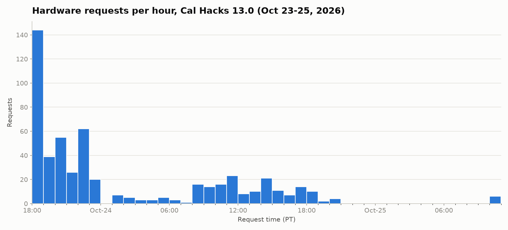
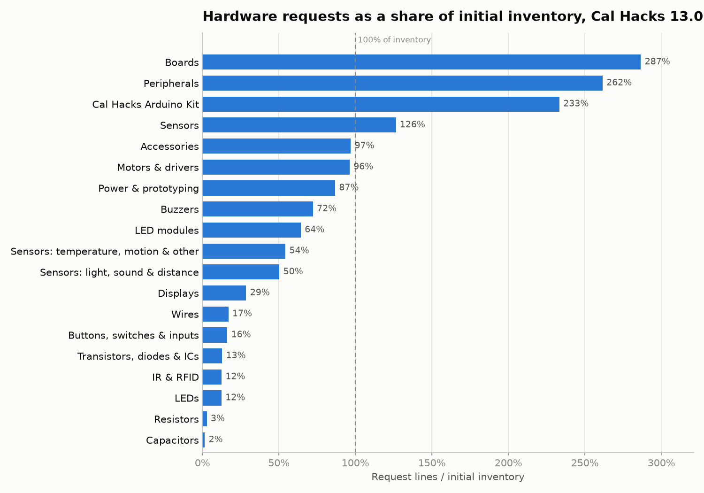

# Cal Hacks 13.0 Hardware Checkout Analysis

An exploration of the hardware checkout system used at Cal Hacks 13.0 (October 23–25, 2026). The goal is to understand how hackers actually requested and used hardware so the next hackathon can run the lending desk more efficiently, stock it more accurately, and give hackers a better experience.

## Data

| File | What it holds |
|---|---|
| `cleanedData/hardware_requests.csv` | One row per request: hacker id, when, status, and the items list |
| `cleanedData/hardware_items.csv` | One row per unit requested, with item name and category |
| `cleanedData/hardware_initial_inventory.csv` | Starting stock per item and category |
| `cleanedData/checked_in_hackers_teams.csv` | One row per checked-in hacker: hacker id, team status, project, Devpost team size, hardware-hack flag |
| `cleanedData/duplicate_requests.csv`, `cleanedData/unique_requests.csv` | Outputs of the duplicate-order pass (see below) |

The raw exports in `rawData/` contain hacker names, emails, and staff names, so that folder is git-ignored. `analysisScripts/anonymize_data.py` produces the de-identified copies above: each hacker becomes a stable `hacker_id` (keyed on email) and each staff member a `staff_id`, so per-person analysis still works without any names in the repository. The name-to-id mapping is written to `rawData/name_mapping.csv` and stays local.

`analysisScripts/anonymize_checked_in.py` applies the same mapping to the checked-in hackers export, which lists names but no emails. It links each name to its email through the raw request exports, so a checked-in hacker who requested hardware keeps the `hacker_id` used in the request tables. Hackers who never requested anything get new ids continuing the sequence, and those are appended to the mapping file. A few checked-in names belong to two different people; when one of those names also made a request, both rows share that request's id and `name_ambiguous` is set to `yes`.

## Findings so far

### Demand is front-loaded and follows the working day

Requests spike in the first hour after checkout opens on Friday evening and stay elevated through the rest of that night. On Saturday, demand rises again through the daytime working hours and falls off overnight. Almost nothing is requested on Sunday morning.



For the desk, this means the heaviest staffing and the most pre-staged kits are needed in the opening hours, with a second, smaller push during Saturday daytime.

### Several categories were requested more than we stocked

Comparing request lines against the initial inventory, four categories were oversubscribed: boards, peripherals, Cal Hacks Arduino kits, and sensors. Boards were requested almost three times as often as there were boards to lend.



Bulk components such as resistors, capacitors, and wires were heavily overstocked relative to requests. Shifting budget from those toward boards, kits, peripherals, and sensors is the clearest inventory change for next year.

Note that the request side counts request lines, not units, so demand for bulk parts is understated. The direction of the finding holds either way.

## Scripts

All scripts run from the repository root and read from `cleanedData/`.

| Script | Purpose |
|---|---|
| `analysisScripts/anonymize_data.py` | Builds the de-identified CSVs in `cleanedData/` from `rawData/` (needs the raw exports locally) |
| `analysisScripts/anonymize_checked_in.py` | Builds `cleanedData/checked_in_hackers_teams.csv`, reusing request `hacker_id`s and numbering the remaining hackers (run after `anonymize_data.py`) |
| `analysisScripts/initial_exploration.py` | Hourly histogram of request times; `plotData` and `binMinutes` control the subset and granularity |
| `analysisScripts/explore_means.py` | Average units per request over time bins |
| `analysisScripts/hardware_mapping.py` | Requests versus initial inventory per category, grouped bars |
| `analysisScripts/hardware_iventory_request_comparison.py` | Requests as a percentage of initial inventory per category |
| `analysisScripts/clean_data.py` | Flags duplicate orders (same hacker, same or subset parts, within a short window) and writes a deduplicated request table |

Install dependencies with `pip install -r requirements.txt`, then for example:

```
python analysisScripts/initial_exploration.py
python analysisScripts/clean_data.py --window 20 --rule exact
```

## Open questions

- How much of the first-hour spike is duplicate or speculative ordering versus real demand? The duplicate pass in `clean_data.py` is the first step toward answering this.
- How long did hackers hold items, and did any categories run dry mid-event rather than just on paper?
- Do cancelled requests cluster around items that were out of stock at the time?
